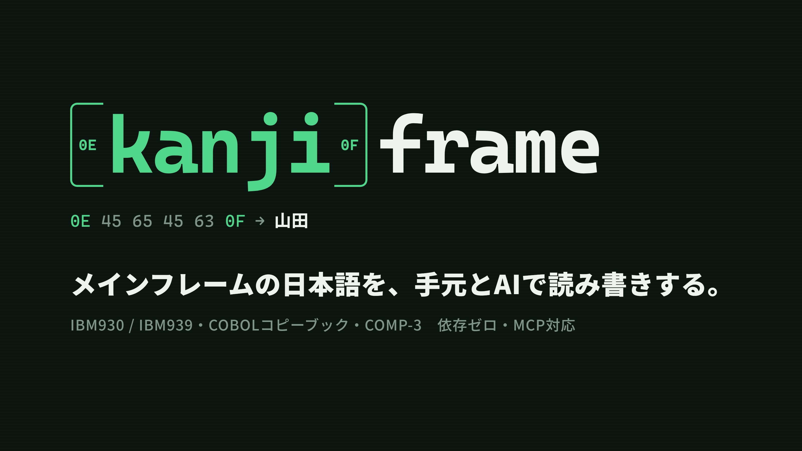

# kanjiframe

**メインフレームの日本語データ（EBCDIC のカナ・漢字、COBOL のレコード）を、開発PCや AI エージェントから読み書きするツール。**
Python 標準ライブラリだけで動きます（依存ゼロ）。旧名は ebcdicjp です。

*kanjiframe reads and writes Japanese mainframe data — EBCDIC IBM930/939 kana and kanji with SO/SI, COBOL copybook layouts, packed and zoned decimals — with zero dependencies. CLI, Python codecs and an MCP server for AI agents.*

## なぜ

メインフレームの移行・保守では、本番から抜いた固定長データ（コピーブック付き）を開発PCで確かめたい場面がよくあります。
でも、Python の標準ライブラリには日本語 EBCDIC（IBM930 / IBM939）のコーデックがありません（`cp930` は `LookupError`）。
欧米向けの手順（cp037）では、漢字の SO/SI やカナ／英小文字の違いを扱えず、変換は商用製品に頼ることになります。

## できること

```
$ kanjiframe layout CUSTMAST.cpy
CUST-REC  length=224
     1    10  zoned       CUST-REC.CUST-NO  9(10)
    11    30  text        CUST-REC.CUST-KANA  X(30)
    41    40  dbcs        CUST-REC.CUST-KANJI  N(20)
    89     8  packed  V2  CUST-REC.BALANCE  S9(13)V99
    ...

$ kanjiframe view CUST.dat -c CUSTMAST.cpy --format md --use ADDR-JP
note: code page: IBM930 (IBM939 would read 30 bytes as lowercase letters with only 17% vowels — ...)
## record 1
| CUST-KANJI | 山田太郎 |
| BALANCE | 1234567.89 |
| ADDR-JP.ADDR-REST | 千代田区丸の内１−１−１ |
...

$ kanjiframe check EMPMAST.dat -c EMPMAST.cpy --key EMP-ID
note: copybook is not UTF-8; read it as Shift_JIS (cp932)
note: assumed RDW variable-length records (6 records): ...
record 3  EMP-ID=E0000003  EMP-REC.ALLOWANCES(1).ALLOW-NAME  pos 92  [0E 46 50 ...]  bad-shift: ... (missing SI)
record 4  EMP-ID=E0000004  EMP-REC.EMP-NAME-KANJI  pos 13  [... 69 41 ...]  gaiji: user-defined character (外字) 6941
record 6  EMP-ID=E0000006  EMP-REC.DEPT-CD  pos 79  [C1 F1 C2 F2]  bad-number: byte 1 of the field (C1) is not a digit
```

- **コーデック**：IBM930（カナ）・IBM939（英小文字）。SO(0E)/SI(0F) で切り替わる漢字、PIC N（SO/SI なしの2バイト）。
  `b"...".decode("ibm930")` のように Python の `codecs` からも使えます。
- **数値**：パック10進（COMP-3）、ゾーン10進（符号付き・SIGN SEPARATE）、バイナリ（COMP）。金額は Decimal で桁を落としません。
- **コピーブック**：PIC X / N / G / 9 / S9 / V、COMP-3 / COMP / BINARY / DISPLAY-1、OCCURS（DEPENDING ON は最大で配置）、REDEFINES、FILLER、固定形式（1〜6桁目の連番・7桁目のコメント）。
- **問題の場所を示す**：読めないバイト、外字、SO/SI の崩れ、数字でないパック10進などを「項目のパス（OCCURS の何番目かも）・バイト位置（1始まり）・実際のバイト」で報告します。黙って置き換えません。`check` でファイル全体の問題を社員番号などのキー付きで一覧できます。
- **決めつけずに推定する**：コードページ（IBM930/939）、RDW の有無、コピーブックの文字コード（UTF-8/Shift_JIS）はデータから判定し、何を仮定したかを `note:` で必ず表示します。英小文字が無くても、半角カナの読み方の崩れ（`tﾕnﾞ` のように英小文字とカナが混ざる）で見分けます。それでも決められないときは「code page UNCERTAIN」と出し、終了コード1にします。
- **戻らない文字を知らせる**：「〜」(U+301C) は 43A1 に変換され、読み戻すと「～」(U+FF5E) になります。こうした文字（IBM930 で53種、IBM939 で54種）を書き込み時に報告します。
- **テストデータを作る**：JSON から固定長の EBCDIC ファイルを作ります（`encode`）。
- **AI エージェントから使う**：MCP サーバー（`describe_layout` / `read_records` / `write_records` / `decode_bytes` / `encode_text` / `detect_codepage`）。

## 正しさの確かめ方

変換表は JDK（Java）の `x-IBM930` / `x-IBM939` から生成し（`tools/GenTables.java`）、テストで次を突き合わせています。

- 2バイトの全コード（各 11,635 個）が JDK と同じ文字になること
- 漢字・カナ・英数・半角カナを混ぜたランダムな 1,200 個の文字列が、JDK と**同じバイト列**（SO/SI の位置を含む）になること
- Java で独立に作ったデータファイル（`tools/MakeSample.java`）を正しく読めること

`java` が入っていればこの突き合わせも実行されます。

## インストールと使い方

```bash
pip install git+https://github.com/yukijames25/kanjiframe
kanjiframe layout CUSTMAST.cpy                          # 項目の位置と長さ
kanjiframe view   CUST.dat -c CUSTMAST.cpy -n 5          # JSONL（--format csv / md も可）
kanjiframe check  CUST.dat -c CUSTMAST.cpy --key CUST-NO # 全件の問題を1行ずつ（キー付き）
kanjiframe dump   CUST.dat -c CUSTMAST.cpy --skip 4 -n 1 # 5件目の項目ごとの16進と値（文字化けの調査）
kanjiframe detect CUST.dat -c CUSTMAST.cpy               # IBM930 と IBM939 のどちらか
kanjiframe encode records.jsonl -c CUSTMAST.cpy -o TEST.dat --codepage ibm930   # テストデータを作る
kanjiframe text --encode "山田〜"                        # 文字列 → 16進（戻らない文字も表示）
kanjiframe text 0E 45 65 45 63 0F                        # 16進 → 文字列（930 と 939 で違えば両方）
```

- `--codepage ibm930|ibm939`：推定を上書きするとき（読むときの既定は auto。`encode` では必ず指定）
- `--rdw` / `--no-rdw`：可変長（各レコードの先頭に4バイトの RDW）かどうか。既定はファイルから判定
- `--use ADDR-JP`：REDEFINES のどの読み方を使うか（どちらで読んでも文字として成り立つことがあるため、レコード種別の規則を知っている人が指定します）
- `--use HOJIN-DETAIL:TOR-KBN=1 --use KOJIN-DETAIL:TOR-KBN=2`：法人と個人のようにレコード区分で読み方が変わるファイルを、1回で正しく読む（値はカンマで複数可。どの規則にも当たらない区分は `no-rule` として報告）
- `--copybook-encoding cp932`：コピーブックの文字コード（既定 auto：UTF-8、だめなら Shift_JIS）

**Claude Code から使う**

```bash
claude mcp add kanjiframe -- kanjiframe-mcp
```

`.claude/skills/kanjiframe/` に、エージェント向けの手順（スキル）があります。

**終了コード**：0 = 問題なし、1 = 問題あり（またはコードページを決められない）、2 = エラー（ファイルが無い、コピーブックが読めないなど）。
`view` / `check` の最後の行が件数のまとめです。数値項目が空白（blank）のものは問題とは別に数えます。

## 制限

- 対応する文字コードは IBM930 / IBM939（日本語 EBCDIC の代表的な2つ）です。KEIS（日立）・JEF（富士通）は、仕様を確かめてから対応予定です。
- 外字（ユーザー定義領域 6941〜7FFE）は、各社の外字表が無いと何の字か分かりません。値には「〓」を出し、問題（kind `gaiji`、コード付き）として報告します。Python から `keep_gaiji=True` で読むと私用領域（U+E000〜）の文字のまま受け取れます。
- COMP-1 / COMP-2（浮動小数点）、SIGN の符号位置が特殊なもの、RENAMES（66 レベル）は未対応です。
- REDEFINES は、どちらの読み方も表示し、片方だけが正しく読めるときはもう片方を「alternative」として目立たなくします。どちらも文字として読めてしまう場合は `--use` で指定してください。
- 読めなかった値は、JSON では null、CSV と Markdown では `#ERR` になります（空の項目と区別するため）。

## 開発

```bash
python -m unittest discover -s tests           # java があれば JDK との突き合わせも
java tools/GenTables.java local && python tools/build_tables.py local   # 変換表の再生成
java tools/MakeSample.java tests/data/custmast_930.dat                 # サンプルデータの再生成
```

選んだ理由と調査は [docs/RESEARCH.md](docs/RESEARCH.md)。

License: MIT
